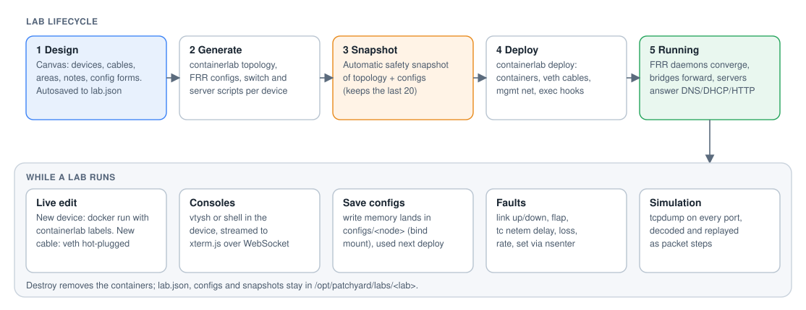
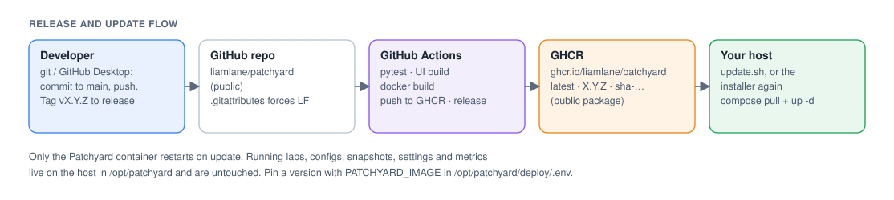

# netlab

A self-hosted network lab that looks like Packet Tracer and runs real protocols underneath. Every device on the canvas is a real Linux container. Routers run FRR (OSPF, BGP, MPLS/LDP, VRFs), switches are 802.1Q Linux bridges with STP or Open vSwitch with RSTP and LACP, firewalls run nftables, and servers run real DHCP, DNS, HTTP, FTP, TFTP, Syslog and NTP. The browser UI is for building, configuring, breaking and watching them.

Personal tool. Runs on FLT-NETLAB-01 (Ubuntu 24.04 VM on Proxmox PV2).


## What it does

- **Build** topologies by drag and drop: routers, switches, firewalls, PCs, laptops and servers, joined by copper, fibre or serial cables. You can add notes and coloured areas, then align and snap them. Undo/redo, a command palette (Ctrl+K) and dark mode are included.
- **Configure** each device through a Packet Tracer-style Config tab (a page per setting and per interface, current values read back from the device, the equivalent IOS commands shown), or in the CLI tab with **IOS syntax** (`conf t`, `int g0/0/0`, `router ospf 1`, `switchport mode trunk`, `?` help, Tab completion), FRR's `vtysh`, or a shell.
- **Firewall**: zone-based stateful firewall (nftables) with ASA-style security levels, ordered rules with hit counters, PAT and port forwards.
- **Services**: a Packet Tracer-style Services tab per server, one page per service with an On/Off switch and a live running light:
  - DHCP: pool, gateway, DNS, domain, TFTP option 150/66, lease time, MAC reservations and a live lease table;
  - DNS: A and CNAME records;
  - HTTP: an editable index page with preview;
  - FTP: user accounts and a shared folder, with a `ftp SERVER` client on every PC;
  - TFTP: `copy running-config tftp://…` backups from the IOS CLI;
  - Syslog: a filterable log viewer fed by `logging host`;
  - NTP.
  Files in the FTP and TFTP folders can be uploaded, downloaded and deleted from the browser.
- **Hardware**: pick a model for any device and drag modules into its slots:
  - routers take GE copper, SFP, 10G SFP+ and serial T1 modules;
  - switches take SFP and SFP+ uplink modules;
  - PCs, laptops and servers take a swappable NIC (Fast Ethernet, Gigabit, SFP, 10G).
  SFP ports take fibre optics or a copper (RJ45) transceiver, so copper devices can plug into fibre switches. You cable by port name (Gi0/0/0, Fa0/1, Se0/1/0) and can power devices off and on. Cables must match the port media, a module or transceiver change that would strand a cable is refused, and links run at the port speed.
- **Run** the lab with one click. containerlab starts the containers and wires the cables. Devices and cables you add to a running lab start and connect straight away, without a redeploy.
- **Watch** live throughput, drops and errors per port, CPU and memory per device, and routing tables with OSPF/BGP/LDP state. History is kept for 48 hours, and a traffic overlay shows load on the cables.
- **Alert** on a stopped device, a link down, BGP/OSPF/LDP sessions, CPU, memory, throughput, errors, or ping-probe loss/RTT. Alerts appear as toasts and a bell badge, with a history you can acknowledge.
- **Break** links on purpose: up/down, flapping, or netem delay, jitter, loss, rate limits and corruption. Presets cover 4G, satellite, lossy Wi-Fi and a congested WAN.
- **Test** with the iperf3 traffic generator between any two devices, check every host can reach every other with the reachability matrix, and step through real packet captures in Simulation mode.
- **Manage** labs from ten templates: OSPF triangle, OSPF multi-area, BGP between three ASes, serial WAN hub-and-spoke, router-on-a-stick, campus with STP, campus RSTP + LACP, small office, firewall edge with DMZ, and the dual-ISP MPLS L3VPN. Snapshots can be diffed and restored, and labs can be cloned or exported/imported as zip files. Global settings and an optional login are included.

## Screenshots


| | |
| --- | --- |
|  |  |
| Router Config tab: a page per interface (here a T1 serial module port), current values, the IOS commands sent | Physical tab: pick the model, drag modules into slots, port lights and cable peers |
|  |  |
| Switch Config tab (Open vSwitch engine): LACP port-channel trunking VLAN 10 and 20 | Firewall Config tab: PAT and port forwards with hit counters |
|  |  |
| Server Services tab: DHCP pool, options, reservations and live leases | Alert rules with hold times, severities and ping probes |


## Built with

| Layer | What |
| --- | --- |
| Lab runtime | [containerlab](https://containerlab.dev) 0.82, Docker Engine, Linux veth pairs, network namespaces |
| Routing | [FRR](https://frrouting.org) 10.0: OSPF, BGP, MPLS/LDP, VRFs, static routes |
| Switching | Linux bridge with `vlan_filtering` (802.1Q, 802.1D STP) or Open vSwitch (RSTP, LACP port-channels), SVI |
| Firewall | nftables (zones, stateful rules, masquerade, DNAT) on Alpine |
| Hosts | `network-multitool` PCs; Alpine servers with dnsmasq (DNS/DHCP), nginx (HTTP), vsftpd (FTP), tftp-hpa, rsyslog, chrony |
| Backend | Python 3.12, FastAPI, uvicorn, SQLite (metrics and alert history), scapy (packet decode) |
| Network tooling | iproute2, `tc netem`, `nsenter`, tcpdump, iperf3, ping |
| Frontend | React 18, React Flow (`@xyflow/react`) canvas, xterm.js consoles, Vite |
| Packaging | Docker image, docker compose, GitHub Actions, GitHub Container Registry |
| Host | Ubuntu 24.04 VM on Proxmox, kernel modules `mpls_router mpls_iptunnel vrf 8021q bridge sch_netem dummy openvswitch` |

## How it works


netlab is one privileged container on the VM. It serves the UI and the API on port 8080, and uses the host's Docker socket and containerlab to run each lab device as its own container. Because it shares the host's network, PID and cgroup namespaces, it can:

- read each device's interface counters from `/proc`,
- read CPU and memory from cgroups,
- step into any device with `nsenter` to apply `tc netem`, run iperf3 or ping probes, or capture packets.

Everything that has to survive an update lives in `/opt/netlab` on the host: labs, configs, snapshots, settings and metrics.



The full walk-through is in [docs/architecture.md](docs/architecture.md): deploy, live edit, monitoring, alerting, fault injection, simulation, storage and security.

## Run it

One-time setup on the VM:

```bash
git clone https://github.com/liamlane/netlab.git && cd netlab
echo "<token with read:packages>" | sudo docker login ghcr.io -u liamlane --password-stdin
./deploy/setup.sh ghcr.io/liamlane/netlab:latest
```

Then open `http://<vm-ip>:8080`.

`setup.sh` does the following:

- loads the kernel modules now and at every boot,
- installs Docker if it's missing,
- stops the old systemd install if there is one,
- writes `/opt/netlab/deploy/{docker-compose.yml,.env}`,
- starts the container.

## Update



Commit and push from GitHub Desktop. Actions tests the code, builds the image and publishes it to GHCR. Then on the VM:

```bash
cd ~/netlab && git pull && ./deploy/update.sh
```

Running labs keep running while netlab restarts. To pin a version, set `NETLAB_IMAGE=ghcr.io/liamlane/netlab:0.11.0` in `/opt/netlab/deploy/.env`. To build on the VM instead, run `sudo docker build -t netlab:local .` and set `NETLAB_IMAGE=netlab:local`.

## Security

netlab runs privileged with the Docker socket, so anyone who can reach it controls the VM. Turn on the login (Settings → Security). Publish netlab only through a reverse proxy with authentication, and firewall port 8080 to that proxy. If you're locked out, run `sudo docker exec netlab python -m app.auth reset`.

## Repository

| Path | What |
| --- | --- |
| `app/backend` | FastAPI app: `main` (routes), `labs`, `devices`, `hardware` (models, modules, transceivers, ports), `ios` (IOS-syntax CLI), `cfgstate` (Config tab state), `firewall`, `live`, `metrics`, `alerts`, `monitor`, `impair`, `traffic`, `capture`, `labmgmt`, `templates`, `settings`, `auth` |
| `app/frontend` | React UI (Vite) |
| `labs/` | The original Phase 1 and Phase 2 containerlab labs, with deploy/verify scripts and the Phase 2 generator |
| `deploy/` | `docker-compose.yml`, `setup.sh`, `update.sh` |
| `tools/` | `netlab-preflight.sh` host checks |
| `tests/` | pytest suite (runs in CI) |
| `docs/` | Architecture notes, build log, images |

## Develop

```bash
python3 -m venv .venv && . .venv/bin/activate
pip install -r app/backend/requirements-dev.txt
pytest -q tests
cd app/frontend && npm ci && npm run dev        # UI on :5173, proxies /api to :8080
```

[ROADMAP.md](ROADMAP.md) lists what's next. [CHANGELOG.md](CHANGELOG.md) lists what changed.
