# Patchyard

A self-hosted network lab that looks and feels like Packet Tracer but runs real protocols underneath. Every device on the canvas is a real Linux container:

- **Routers** run FRR: OSPF, BGP, MPLS/LDP, VRFs, ACLs, NAT and DHCP relay.
- **Switches** are 802.1Q bridges with STP, or Open vSwitch with RSTP and LACP.
- **Firewalls** run nftables.
- **Servers** run real DHCP, DNS, HTTP, FTP, TFTP, Syslog and NTP.

You build, configure, break and watch it all from a browser, with an IOS-style CLI on every router and switch.

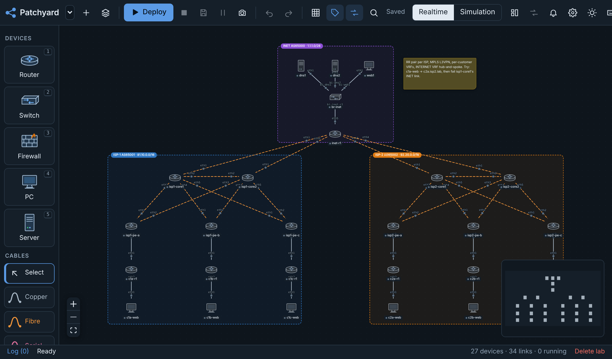

## Install

You need a Linux machine or VM with 4 GB of RAM (8 GB for the big templates), 2+ CPUs and 20 GB of disk. Ubuntu 24.04/22.04 or Debian 12 is the tested path; Fedora, RHEL-family and Arch work on a best-effort basis. x86_64 only for now.

```bash
curl -fsSL https://raw.githubusercontent.com/liamlane/patchyard/main/deploy/install.sh | sudo bash
```

The installer does the following:

- installs Docker if it's missing,
- loads the kernel modules,
- starts Patchyard,
- asks you for an admin password.

Then open `http://<host>:8080` and pick a template from the Lab manager. Options (port, data folder, listen address, no login) and the details are in **[docs/install.md](docs/install.md)**. Running it in a VM on Proxmox: **[docs/proxmox.md](docs/proxmox.md)**.

**Hosting it for other people** on a public VPS, with HTTPS, invite links, per-user private labs, limits and sandboxed lab devices:

```bash
curl -fsSL https://raw.githubusercontent.com/liamlane/patchyard/main/deploy/install.sh \
  | sudo bash -s -- --public --domain lab.example.com --email you@example.com --admin yourname
```

See **[docs/vps.md](docs/vps.md)**.

Update with `sudo /opt/patchyard/deploy/update.sh`. Settings → About tells you when a new release is out.

## What it does

### Build

- Drag and drop routers, switches, firewalls, PCs, laptops and servers, and join them with copper, fibre or serial cables.
- Add notes and coloured areas, then align and snap them.
- Undo/redo, a command palette (Ctrl+K) and dark mode are built in.

### Hardware

Every device can have a hardware model with slots for modules:

- **Routers** take GE copper, SFP, 10G SFP+ and serial T1 modules.
- **Switches** take SFP and SFP+ uplink modules.
- **PCs, laptops and servers** take a swappable network card.

SFP ports take fibre optics or a copper (RJ45) transceiver. You cable by port name (Gi0/0/0, Fa0/1, Se0/1/0), and the cable must match the port. Links run at the port speed, and devices can be powered off and on.

### Configure

Each device has a Packet Tracer-style **Config** tab:

- one page per setting and per interface,
- current values read back from the device,
- the equivalent IOS commands shown under the form.

Or use the **CLI** tab, which takes IOS syntax (`conf t`, `int g0/0/0`, `router ospf 1`, `switchport mode trunk`, `ip nat inside`, `?` help, Tab completion). FRR's `vtysh` and a shell are also there.

### Routers

- **Routing:** static routes, OSPF (multi-area), BGP (iBGP and eBGP, VPNv4), MPLS/LDP, VRFs.
- **Access lists:** standard and extended, numbered and named, `ip access-group` in/out, `show access-lists` with hit counts.
- **NAT:** PAT, static NAT, port forwards and pools.
- **DHCP relay:** `ip helper-address`.

### Switches

- VLANs, access and trunk ports, and a management SVI.
- STP on the Linux bridge, or RSTP and LACP port-channels on the Open vSwitch engine.

### Firewalls

- Zones with ASA-style security levels.
- Ordered stateful rules with hit counters.
- PAT and port forwards.

### Servers

A Services tab with a page per service, each with an On/Off switch and a running light:

- **DHCP:** pools per subnet, reservations and live leases.
- **DNS:** A and CNAME records.
- **HTTP**, **FTP** (with users), **TFTP** (config backups from the IOS CLI), **Syslog** (fed by `logging host`) and **NTP**.

### Run

- Deploy with one click: containerlab starts the containers and wires the cables.
- Devices and cables added to a running lab start and connect straight away.

### Watch and alert

- Live throughput, drops and errors per port, and CPU and memory per device.
- Routing tables with OSPF, BGP and LDP state, plus 48 hours of history and a traffic overlay.
- Alerts on devices, links, routing sessions, thresholds and ping probes.

### Break and test

- Take links down or make them flap, and add delay, jitter, loss, rate limits and corruption, with presets.
- Run iperf3 traffic tests and a reachability matrix.
- Step through real captured packets in Simulation mode.

### Share a server

- **Accounts by invite link.** Each person's labs are private to them; admins see everything.
- **Per-user limits:** labs, labs running at once, devices per lab, memory and CPU per device.
- **On a public server** (`--public`), lab devices are sandboxed:
  - unprivileged containers,
  - a management network per lab,
  - no internet except package mirrors.
- **HTTPS** comes from Let's Encrypt.

### Manage

- **12 templates:**
  - OSPF triangle and OSPF multi-area,
  - BGP between three ASes,
  - serial WAN,
  - router-on-a-stick,
  - campus STP and campus RSTP + LACP,
  - NAT and ACLs at the edge,
  - central DHCP with relay,
  - small office,
  - firewall edge with DMZ,
  - dual-ISP MPLS L3VPN.
- **Labs:** snapshots with diff and restore, clone, and zip export and import.
- **Access:** an admin login.

## Screenshots

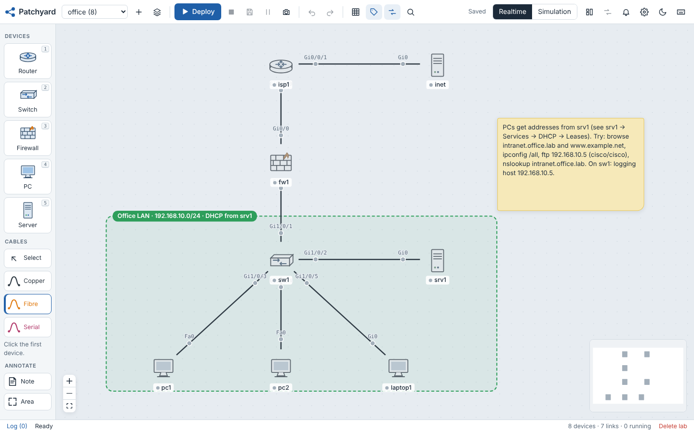

| | |
| --- | --- |
| 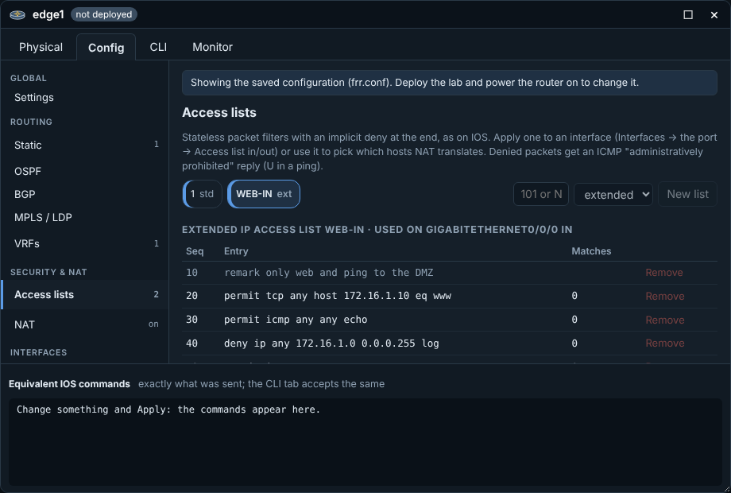 | 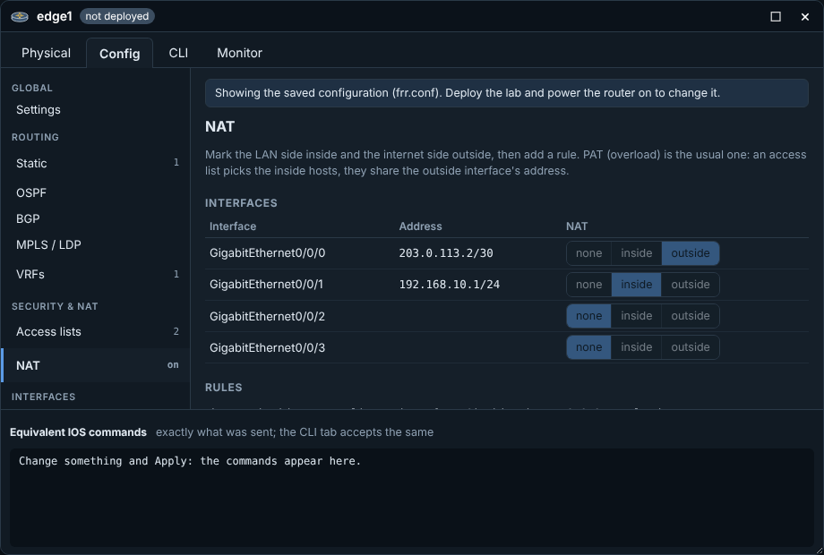 |
| Router access lists with hit counts and an entry builder | Router NAT: inside/outside per interface, PAT, static NAT, pools |
| 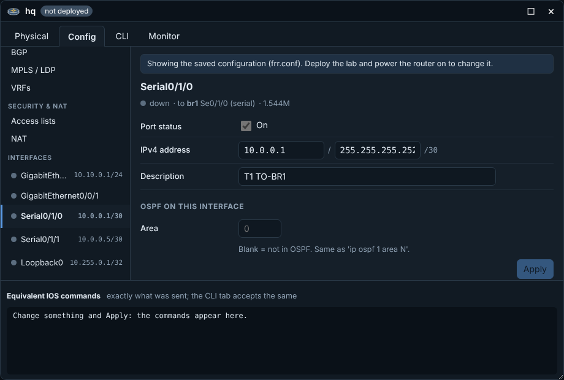 | 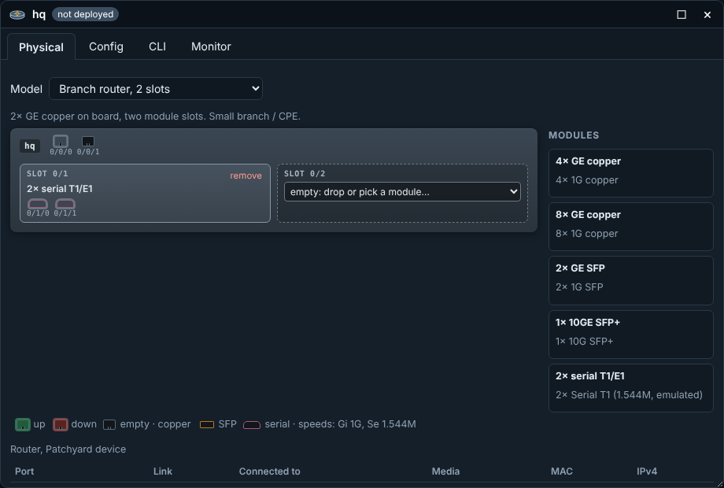 |
| A page per interface, current values, the IOS commands sent | Physical tab: model, modules, port lights, cable peers |
| 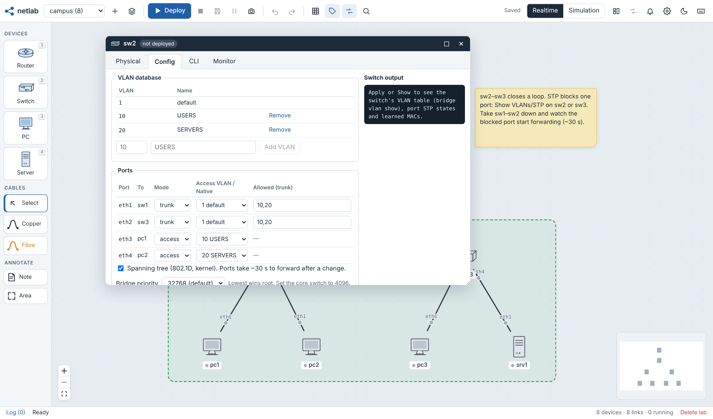 | 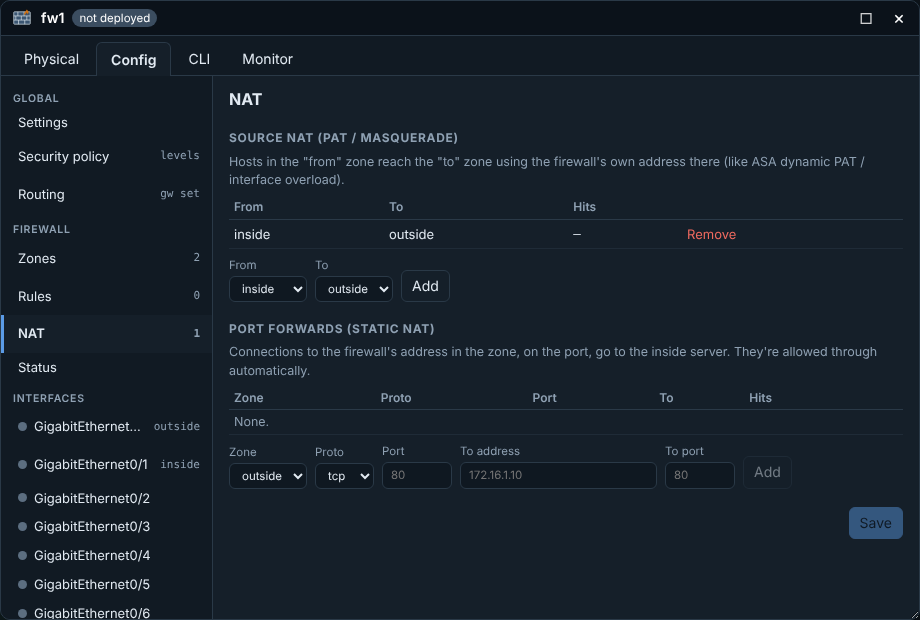 |
| Switch on the Open vSwitch engine: LACP port-channel | Firewall: PAT and port forwards with hit counters |
| 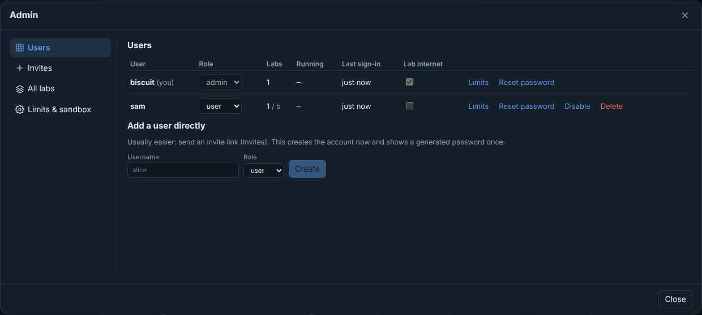 | 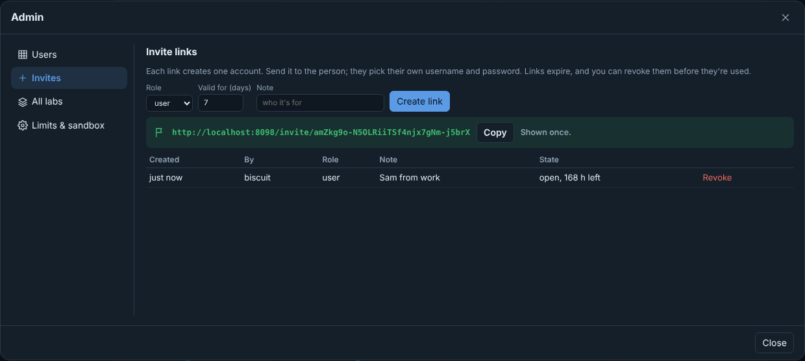 |
| Admin: users, roles, limits, lab internet, reset/disable/delete | Admin: one-time invite links |
| 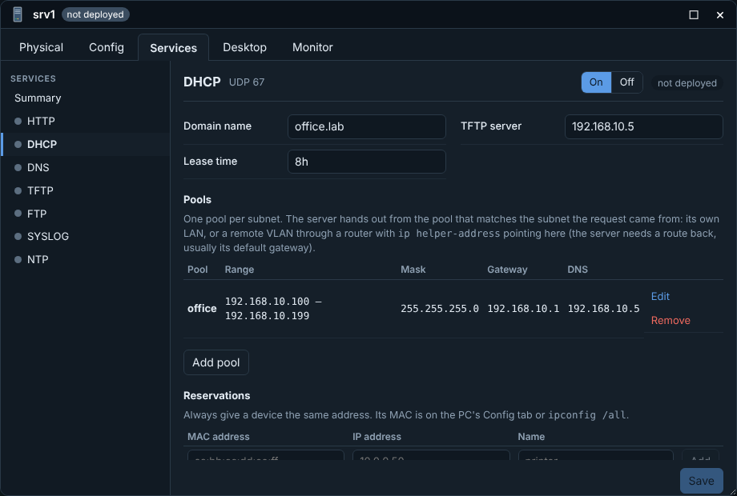 | 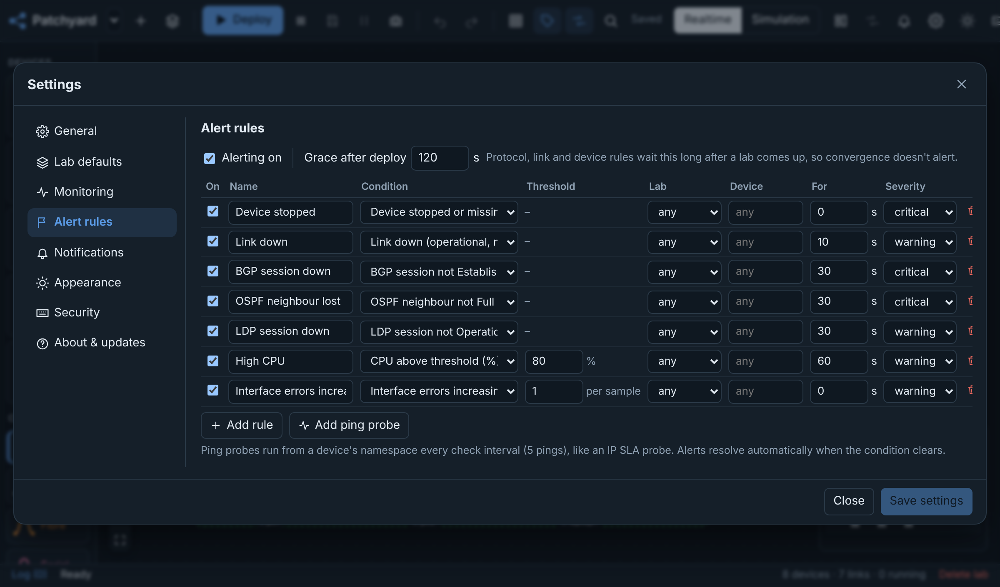 |
| Server DHCP: a pool per subnet, reservations, live leases | Alert rules with hold times, severities and ping probes |

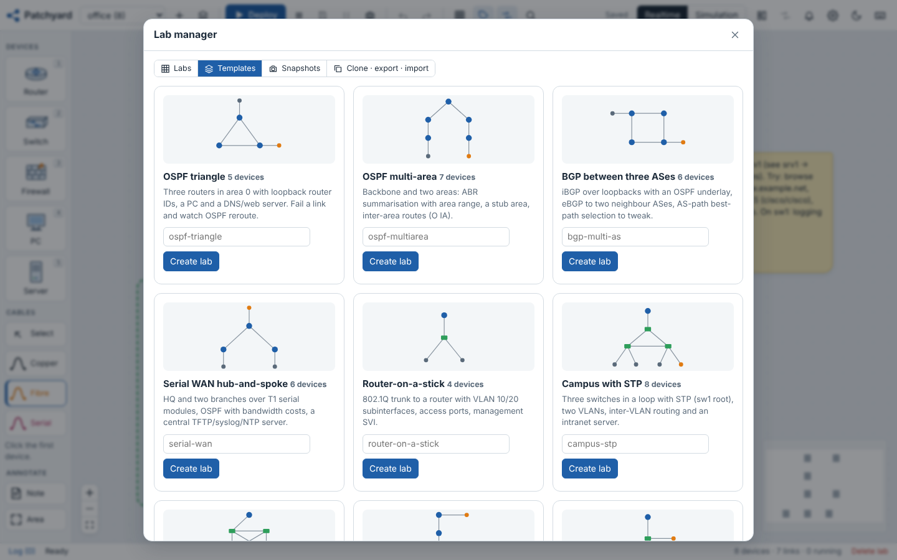

## How it works

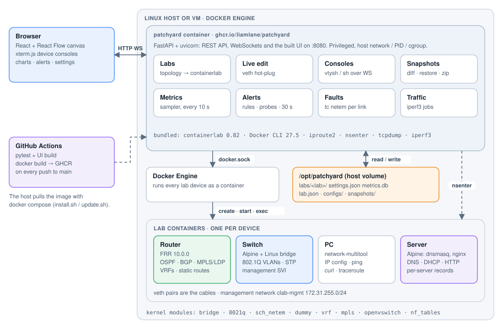

Patchyard is one privileged container on the host. It serves the UI and API (port 8080), and uses the host's Docker and containerlab to run each lab device as its own container. Because it shares the host's network, PID and cgroup namespaces, it can do the following:

- read interface counters and cgroup stats,
- step into any device with `nsenter` to apply `tc netem`, ACL/NAT rulesets and DHCP relays,
- run traffic tests,
- capture packets.

Everything that has to survive an update lives in `/opt/patchyard` on the host: labs, configs, snapshots, settings and metrics.

| Layer | What |
| --- | --- |
| Lab runtime | [containerlab](https://containerlab.dev), Docker Engine, veth pairs, network namespaces |
| Routing | [FRR](https://frrouting.org) 10; ACLs/NAT as nftables in the router's namespace; dnsmasq DHCP relay |
| Switching | Linux bridge with `vlan_filtering`, or Open vSwitch |
| Firewall | nftables on Alpine |
| Hosts | `network-multitool` PCs; Alpine servers with dnsmasq, nginx, vsftpd, tftp-hpa, rsyslog, chrony |
| Backend | Python 3.12, FastAPI, SQLite, scapy |
| Frontend | React 18, React Flow, xterm.js, Vite |
| Packaging | Docker image on GHCR, docker compose, GitHub Actions |

The full walk-through is in [docs/architecture.md](docs/architecture.md).

## Security

Patchyard runs privileged with the host's Docker socket, so anyone who can use it controls the host. Follow these rules:

- **For a server other people use,** install with `--public` (see [docs/vps.md](docs/vps.md)). That sandboxes lab devices, so a shell on a device isn't root on the host.
- **Keep the login on.** The installer turns it on.
- **Keep it on a trusted network,** or publish it only through a reverse proxy that does its own authentication.
- **Bind to localhost behind a proxy:** use `--bind 127.0.0.1` when the proxy runs on the same host.

If you're locked out, run `sudo docker exec patchyard python -m app.auth reset-password <name>`, which prints a new password.

## Licence

Copyright Liam Lane. You're free to install and use Patchyard for personal, educational and other non-commercial work. Redistribution, hosting it as a service, or commercial use need permission. See [LICENSE](LICENSE). Patchyard contains no Cisco software. The IOS-style CLI is a translation layer over FRR and Linux.

Bug reports and ideas are welcome as GitHub issues.

## Develop

```bash
python3 -m venv .venv && . .venv/bin/activate
pip install -r app/backend/requirements-dev.txt
pytest -q tests
cd app/frontend && npm ci && npm run dev        # UI on :5173, proxies /api to :8080
```

To build the image yourself, run `docker build -t patchyard:local .`, then set `PATCHYARD_IMAGE=patchyard:local` in `/opt/patchyard/deploy/.env`.

[ROADMAP.md](ROADMAP.md) lists what's next and [CHANGELOG.md](CHANGELOG.md) lists what changed.
