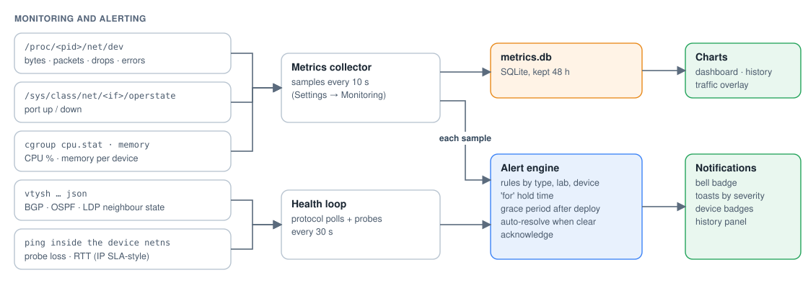

# How netlab works

This document covers how a lab goes from the canvas to running containers and what happens while it runs. It also covers where data is stored and how releases reach the VM.


## The pieces

**The netlab container** is the only thing installed on the VM. It is built from this repo and published to `ghcr.io/liamlane/netlab`. It runs uvicorn with the FastAPI app, which serves:

- the REST API under `/api`,
- the WebSockets under `/ws` (device consoles, live status, Simulation),
- the built React UI.

The image also includes containerlab, the Docker CLI, iproute2, `nsenter`, tcpdump, iperf3 and ping. The netlab container doesn't need any of these installed on the host.

The container runs with:

| Setting | Why |
| --- | --- |
| `privileged`, `pid: host`, `cgroup: host` | Find each device's PID, read its counters and cgroup stats, and `nsenter` into it |
| `network_mode: host` | Create veth pairs and bridges in the host namespace; listen on the VM's :8080 |
| `/var/run/docker.sock` | Run containerlab and `docker run` against the host's Docker Engine |
| `/opt/netlab`, `/home` (same paths) | containerlab bind-mounts config files by host path, so paths must look the same inside and outside the container |
| `/lib/modules:ro` | Load kernel modules at startup if the host hasn't already |

**Lab devices** are ordinary containers on the host's Docker Engine, labelled `containerlab=<lab>` and `clab-node-name=<node>`.

| Device | Image | What runs inside |
| --- | --- | --- |
| Router | `quay.io/frrouting/frr:10.0.0` | FRR daemons (zebra, ospfd, bgpd, ldpd, ...). Kernel MPLS and VRFs enabled per interface. The config directory is bind-mounted so `write memory` persists. |
| Switch | `alpine:3.20` | A generated `netlab-switch` script builds a VLAN-filtering Linux bridge: access/trunk ports, native VLAN, STP priority, management SVI. |
| PC | `ghcr.io/hellt/network-multitool` | Static or DHCP addressing, plus ping, traceroute, curl and dig from the PC desktop. |
| Server | `alpine:3.20` | dnsmasq (DNS records, DHCP scopes) and nginx (HTTP), configured from the server's service forms. |

All devices share a management network, `clab-mgmt` (172.31.255.0/24). Lab cables are veth pairs, one end in each device's namespace.

## Lab lifecycle


1. **Design.** The canvas edits a lab document (`lab.json`): devices, cables (copper/fibre), per-device properties and annotations. The UI autosaves it.
2. **Generate.** Deploy turns `lab.json` into a containerlab topology (`netlab-<lab>.clab.yml`) and per-device files:
   - FRR `frr.conf` and `daemons`,
   - switch scripts,
   - dnsmasq/nginx configs,
   - exec hooks: IP addresses, MPLS input, VRFs, subinterfaces.
3. **Snapshot.** If enabled in Settings, the current topology and configs are snapshotted first. The last 20 automatic snapshots are kept; named snapshots are never pruned.
4. **Deploy.** `containerlab deploy` creates the containers, the veth cables and the management network, then runs each device's exec hooks. Running configs are saved before a redeploy, so nothing typed into a CLI is lost.
5. **Running.** FRR converges, the bridges learn and forward, and the servers answer. The UI's status WebSocket shows each device turn green.

**Destroy** removes the containers. The lab's folder (`/opt/netlab/labs/<lab>`) keeps the topology, configs and snapshots. **Delete lab** removes that folder. It's only allowed once nothing is running.

### Live editing

When live editing is on (Settings → General), changes to a running lab apply immediately:

- **New device:** `docker run` with the same name, labels, binds, management network and exec hooks containerlab would have used. A later `containerlab destroy` still cleans it up.
- **New cable:**
  - a veth pair is created on the host, then each end is moved into its device's namespace and renamed (`eth3` and so on),
  - a per-type hook then runs: switches re-run their bridge script, PCs and servers re-apply addressing, and routers enable MPLS input and re-create subinterfaces.
- **Delete or undo:** the cable is unplugged or the container removed. The UI works out what to apply by comparing the canvas with what is actually running, so drag, duplicate, delete and undo/redo all take the same path.

### Configs

Router config directories are bind-mounted (`configs/<node>:/etc/frr`). FRR's `write memory` writes a temporary file and renames it, which a single-file bind mount would refuse. **Save running configs** (Ctrl+S) runs `write memory` on every router. It reports which devices saved, failed or were skipped.

## Monitoring and alerting



Everything is measured from the host side, so nothing extra is installed in the lab images.

- **Metrics collector** (every 10 s by default) reads:
  - per-port bytes, packets, drops and errors from `/proc/<pid>/net/dev`,
  - port state from `/sys/class/net/<if>/operstate` inside the device's root,
  - CPU and memory from cgroup v2 (falling back to v1).

  Rates are stored in SQLite (`/opt/netlab/metrics.db`), kept for 48 hours by default, and drive the charts, the lab dashboard and the traffic overlay on the cables.
- **Health loop** (every 30 s by default) runs `vtysh -c '... json'` on routers for BGP, OSPF and LDP neighbour state. It also runs ping probes from inside a source device's namespace, like an IP SLA probe, for loss and RTT.
- **Alert engine** checks the rules after every sample and every health pass:
  - each rule has a type, an optional lab/device scope, a threshold, a **for** hold time and a severity,
  - a **grace period** after a lab comes up keeps protocol convergence from alerting,
  - alerts resolve automatically when the condition clears, can be acknowledged, and are kept in an `alerts` table next to the metrics,
  - the UI polls a summary for the bell badge, toasts and device badges.

## Fault injection, traffic, Simulation

- **Faults** apply to one or both ends of a cable, using `tc qdisc ... netem` inside the device's namespace through `nsenter`. Options are delay, jitter, loss, rate, duplication and corruption. Link down/up and flap set the interface state. The presets are combinations of these values.
- **Traffic generator** starts `iperf3 -s` in the destination's namespace and `iperf3 -c` in the source's. Results (throughput, retransmits, or loss and jitter for UDP) come back as JSON.
- **Simulation** runs tcpdump on the lab's ports. scapy decodes the frames (Ethernet, ARP, IP, ICMP, TCP/UDP, DNS, HTTP, OSPF, BGP, LDP, MPLS), and the UI replays them as animated steps on the canvas with per-packet details.

## Storage

```
/opt/netlab/
├── labs/<lab>/
│   ├── lab.json                     topology, device properties, annotations
│   ├── netlab-<lab>.clab.yml        generated containerlab topology
│   ├── configs/<node>/              frr.conf, switch.sh, dnsmasq.conf, nginx.conf ...
│   └── snapshots/                   automatic and named snapshots
├── settings.json                    global settings (defaults merged in)
├── metrics.db                       SQLite: samples, alert history
└── deploy/                          docker-compose.yml + .env (written by setup.sh)
```

Labs imported from an existing containerlab folder (for example the original Phase 1/2 labs in `labs/`) keep their own working directory. netlab only stores its record of them.

## Security model

netlab can start privileged containers and enter any namespace, so it has to be treated as root on the VM. The optional login uses:

- a PBKDF2 password hash,
- an HMAC-signed session cookie,
- an ASGI middleware covering `/api` and `/ws`.

Keep port 8080 behind a reverse proxy with authentication, and don't expose it directly. Reset a lost password with `docker exec netlab python -m app.auth reset`.

## Releases


Every push to `main`:

1. runs pytest and the UI build,
2. builds the image,
3. pushes it to GHCR as `latest` and `sha-<commit>`.

A `vX.Y.Z` tag also publishes `X.Y.Z`. On the VM, `deploy/update.sh` pulls the new image and recreates the container. The labs are separate containers, so they keep running throughout.

## Known limits

- The switch STP is the kernel bridge's 802.1D (about 30 s convergence). RSTP/MSTP needs Open vSwitch or mstpd, which is on the roadmap.
- There are no Cisco images (licensing). The CLI is FRR's `vtysh`, and an IOS-syntax layer is on the roadmap.
- Metrics come from the host and are per-container. They measure the Linux datapath, not a vendor ASIC.
