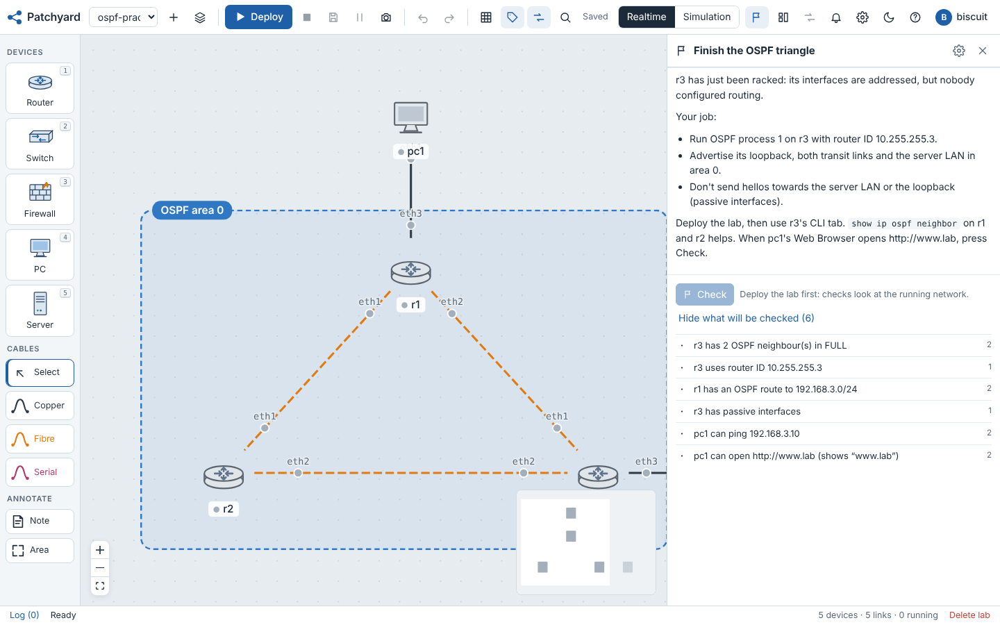
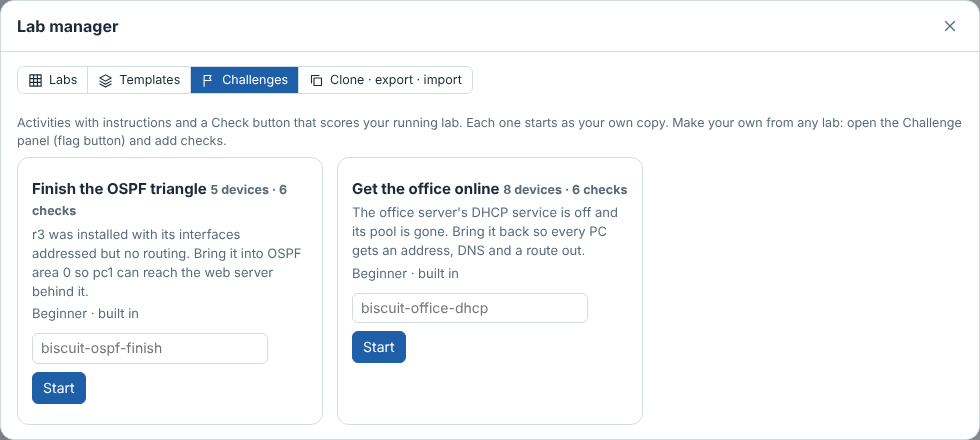
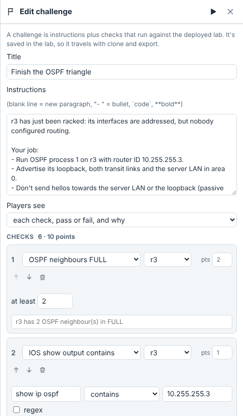

# Challenges

A challenge is a lab with instructions and a **Check** button that scores what you've built, like a Packet Tracer activity. Checks look at the running network (routing tables, neighbour states, pings, web pages, services), so only what really works scores.

## Play one

1. Open **Lab manager** → **Challenges**, pick one and press **Start**. You get your own copy of the lab.
2. The **Challenge** panel (the flag button, top right) shows what to do.
3. **Deploy** the lab and work through it in the CLI and Config tabs.
4. Press **Check** whenever you like. You see your score, and depending on the challenge, which checks passed and why the others didn't. Your best score and the time you first reached 100% are kept.

Five challenges are built in:

| Challenge | Level | Starts from | Task |
| --- | --- | --- | --- |
| Finish the OSPF triangle | Beginner | OSPF triangle | r3 is addressed but has no routing: bring it into area 0 with the right router ID and passive interfaces so pc1 can browse the server behind it |
| Get the office online | Beginner | Small office | srv1's DHCP is off and its pool is gone: rebuild it so every PC gets an address, DNS and a way out through the firewall |
| VLANs and a trunk for router-on-a-stick | Beginner | Router-on-a-stick | sw1 was wiped: recreate VLANs 10 USERS and 20 SERVERS, the access ports and the trunk to r1 |
| Branch edge: PAT, a published server and an ACL | Intermediate | NAT and ACLs at the edge | r1 has no NAT or ACLs: PAT the LAN out, publish web1 on port 80, and an inbound ACL that stops the internet pinging r1 |
| Bring AS65003 online | Intermediate | BGP between three ASes | r4 lost its BGP config: peer with AS65001 and AS65002 and advertise the server LAN |

## Leaderboard

Built-in and published challenges keep a score per player on the server: best score, when they first reached 100%, how long that took from pressing **Start**, and how many times they pressed Check. The Challenges tab shows how many people finished each one, your own best, and the leaderboard.

Only unedited copies count: Patchyard fingerprints a challenge's checks, and a copy whose checks were changed stops posting scores (editing the instructions or labels is fine). Admins can turn the leaderboard off under Admin → Limits & sandbox → Challenges.

## Make one

1. Build the lab in the state players should start from, for example with one router left unconfigured. Press **Save running configs** so the starting configs are stored with the lab.
2. Open the Challenge panel and write a title and instructions. Formatting is simple:
   - a blank line starts a new paragraph,
   - `- ` starts a bullet,
   - `` `code` `` and `**bold**` work inline.
3. Add checks and give each one points.
4. Choose what players see: each check with pass/fail and the reason, pass/fail only, or only the score.
5. Solve it yourself and press **Check** to make sure it reaches 100%. Then put the lab back to its starting state; a snapshot taken in step 1 makes this one click.

The challenge is stored in the lab (`lab.json`), so it goes wherever the lab goes:

- **Clone** it to try variations.
- **Export** it as a zip from Lab manager → Clone · export · import. Anyone can import the zip and play it.
- **Publish** it (admins): the editor has *Publish to everyone on this server*. Patchyard stores a copy of the lab as it is at that moment (design and saved configs). It then appears in everyone's Challenges tab, and each player who starts it gets their own lab. Unpublishing removes it from the list; labs people already started stay.

## Check types

| Check | Passes when | Fields |
| --- | --- | --- |
| Ping | the device gets replies from the target, or gets none when set to *blocked* (for ACL and firewall tasks) | device, address or host name, expect replies / blocked |
| Web page | the device can open the URL (HTTP 2xx/3xx), optionally containing some text | device, URL, text |
| IOS show output | an IOS `show` command on a router or switch contains (or doesn't contain) some text or a regular expression | device, command, text, regex |
| OSPF neighbours | at least *n* neighbours are FULL | router, count |
| BGP sessions | at least *n* peers are Established | router, count |
| Route | the prefix is in the routing table as a selected route, optionally from one protocol (connected, static, OSPF, BGP) | router, prefix, protocol |
| Interface address | a port has exactly this address and prefix length | device, port, address |
| DHCP address | the device has an address inside the subnet | device, subnet |
| Server service | DHCP, DNS, HTTP, FTP, TFTP, Syslog or NTP is running on a server | server, service |

Notes:

- Checks only read state; none of them changes the lab. IOS checks accept `show` commands only.
- A check on a device that isn't running fails with "isn't running", so players know to deploy or power it on.
- Each check has a time limit, and checks run a few at a time, so a big challenge takes a few seconds.
- The text players see for each check is generated from its fields ("r1 has an OSPF route to 192.168.3.0/24"). Type your own in the box under the check to word it differently or to avoid giving the answer away.

## Limits

- Players own their copy, so a determined player can open the editor and read the checks. Challenges are for learning, not exams.
- The score reflects the lab at the moment you press Check: a protocol that flaps between checks can pass one time and fail the next.
