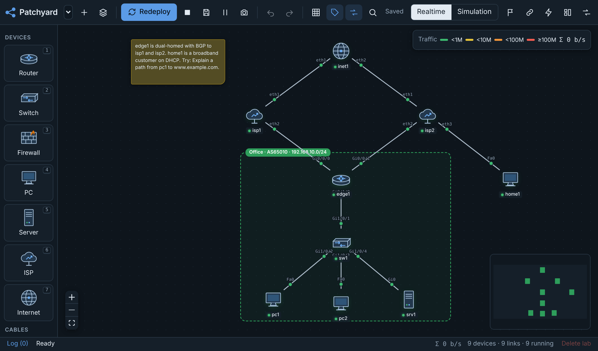
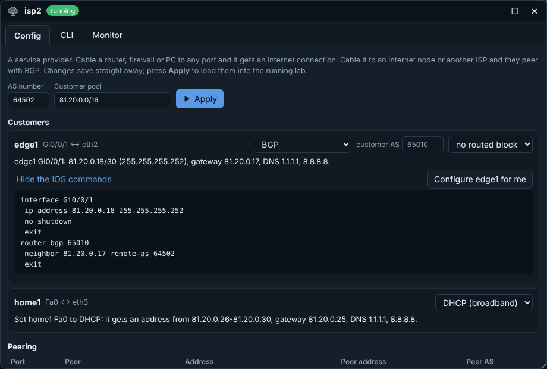
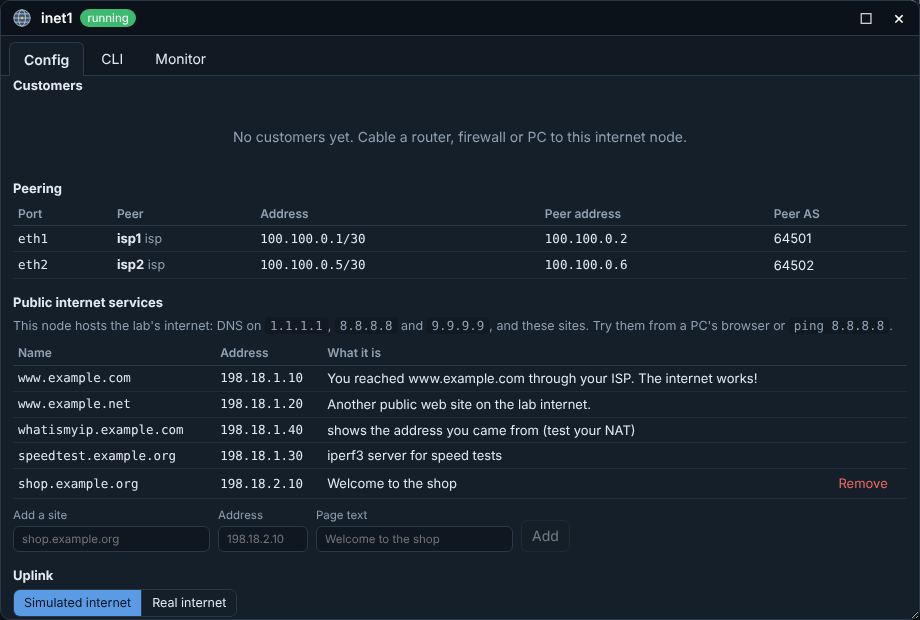
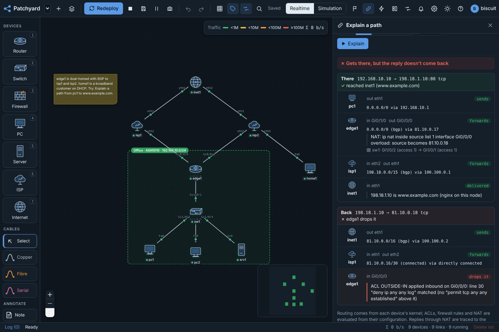
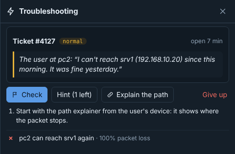
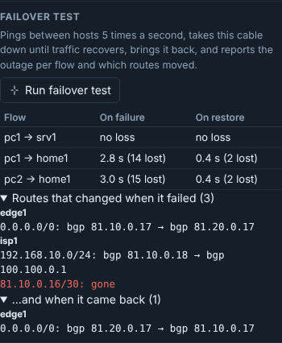
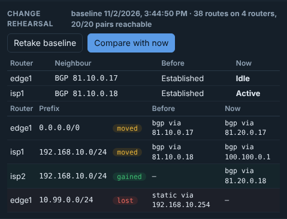
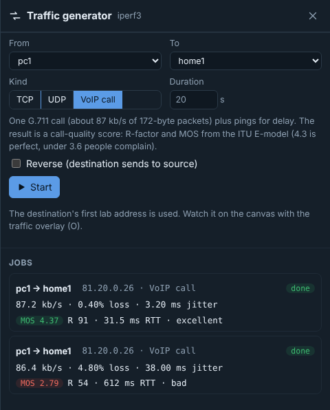
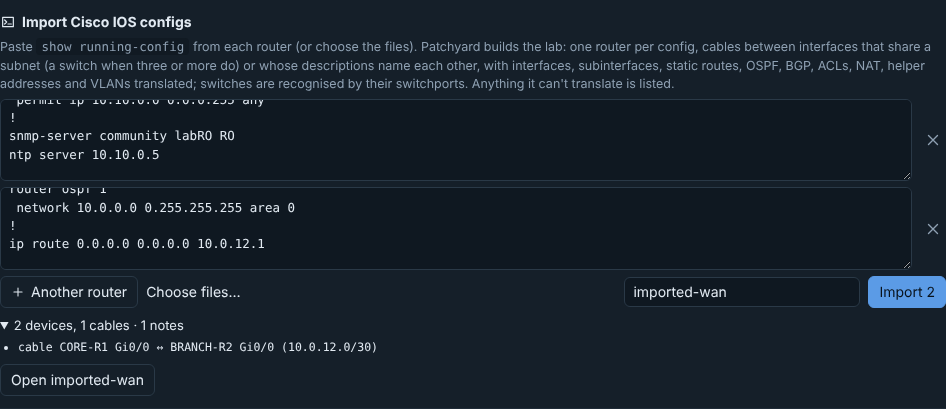
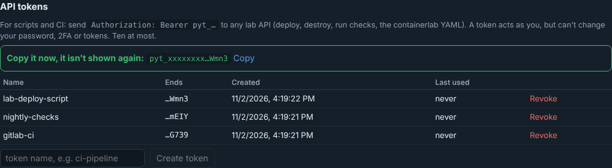

# Internet, troubleshooting and testing

Patchyard 0.15 adds devices that give a lab an internet to connect to, and tools that tell you why traffic does or doesn't get through, break things on purpose, and measure the result.

- [ISP and Internet devices](#isp-and-internet-devices)
- [Explain a path](#explain-a-path)
- [Troubleshooting tickets](#troubleshooting-tickets)
- [Failover test](#failover-test)
- [Change rehearsal](#change-rehearsal)
- [Network tests](#network-tests)
- [VoIP call quality](#voip-call-quality)
- [Importing real configs](#importing-real-configs)
- [API tokens and containerlab YAML](#api-tokens-and-containerlab-yaml)



*Screens showing live results use sample data: the documentation is built without real lab containers.*

## ISP and Internet devices

Drag them from the palette, or press <kbd>6</kbd> (ISP) and <kbd>7</kbd> (Internet).

### ISP

A service provider. Cable a router, firewall or PC to any of its ports and that port is a customer connection. On the ISP's **Config** tab, choose the service per port:

| Service | The ISP | You |
| --- | --- | --- |
| **Static /30** (default) | first address of a /30 | second address, default route via the ISP |
| **DHCP (broadband)** | a /29 served by DHCP, with gateway and DNS | a PC or server set to DHCP (routers and firewalls have no DHCP client: use Static or BGP) |
| **BGP** | /30 plus an eBGP session; sends you a default route and accepts what you announce | `router bgp` with the ISP as neighbour |
| **Routed block** (optional, static or BGP) | routes a /29 or /28 of public addresses to your WAN address | use it for a DMZ or a static NAT pool |

Each port shows the addresses, the IOS commands for your side, and for routers a **Configure … for me** button that applies them (if the router already runs BGP, its existing AS is used). A router cabled to two ISPs keeps one customer AS on both, so dual-homing works out of the box.

Each provider gets its own AS number and customer pool when it's created (ISPs from AS 64501 and `81.10.0.0/16` upwards); you can change both. Two providers can't share an AS or overlapping pools.



### Internet

The core. Cable ISPs to it, or to each other, and they peer over eBGP using `100.100.0.0/16` transit links. The Internet node (AS 64496, `203.0.113.0/24` for anything cabled to it directly) sends ISPs a default route, so customers of one ISP reach customers of another.

It also hosts the lab's public services. With no Internet node, an ISP hosts them itself:

| Name | Address | What it is |
| --- | --- | --- |
| DNS | `1.1.1.1`, `8.8.8.8`, `9.9.9.9` | resolves the names below (and real names with a real uplink) |
| `www.example.com`, `www.example.net` | `198.18.1.10`, `198.18.1.20` | web pages |
| `whatismyip.example.com` | `198.18.1.40` | shows the address your traffic arrived from: the quickest NAT test |
| `speedtest.example.org` | `198.18.1.30` | iperf3 server: `iperf3 -c speedtest.example.org` |
| your own sites | any `198.18.x.x` (or other public-style) address | name, address and page text |

**Uplink:** *Simulated* (default) keeps everything inside the lab. *Real* masquerades anything else out of the node's management interface and forwards unknown names to real DNS. On a public server this only gets out for labs whose owner has "Lab internet".

Changes save straight away. On a running lab press **Apply**. The CLI tab is FRR's `vtysh`, so `show ip bgp summary` works.



## Explain a path

Toolbar (link icon), or right-click a device → *Explain a path from here*. Pick a source, a destination (device, address or name), a protocol and port.

For every hop it shows:

- the device's real routing decision, read from its kernel in the running lab: route, how it was learned, next hop;
- the switches and VLANs the frame crosses;
- the ACL line, firewall rule or NAT rule that matched, read from the device's configuration.

It then traces the reply to the translated source, so asymmetric routing, a missing return route and an ACL that blocks replies stand out. It sends no traffic. If it says traffic gets through but ping fails, look at what it can't see: ARP, MTU or a host firewall.



## Troubleshooting tickets

Toolbar (bolt icon). On a working, deployed lab, Patchyard picks two hosts that can reach each other, traces the path, and breaks something on it:

- a shut interface or a wrong mask;
- a missing OSPF network statement or a deleted static route;
- a stray ACL;
- a PC with the wrong gateway, or a switch port in the wrong VLAN.

Before the ticket is handed over, it checks that the fault really breaks the traffic. You get the user's complaint and a timer. Fix it with real configuration and press **Check**: it passes when the original traffic works again, however you fixed it. Up to three hints. **Give up** reveals the fault and undoes it. **Hard ticket** applies two faults.



## Failover test

Click a cable → **Run failover test**. Patchyard:

1. pings between pairs of hosts five times a second;
2. records every router's routing table;
3. takes the cable down and waits until every flow recovers (60 s at most);
4. brings it back and waits again.

The report shows, per flow, the outage and packets lost on failure and on restore, and which routes each router lost, gained or moved. Flows that didn't work before the test are listed and left out. Use it to compare OSPF timers, BFD, or static against dynamic routing.



## Change rehearsal

Dashboard → **Change rehearsal**. **Take baseline** records every router's routes, every OSPF/BGP/LDP neighbour and the reachability matrix. Make your change, then **Compare with now**:

- routes gained, lost or moved to another next hop;
- neighbours that went down or came up;
- host pairs that broke or got fixed.



## Network tests

A challenge's checks can run on their own: in the challenge editor set **Network tests** to every 1, 5, 15 or 60 minutes. While the lab is deployed, a failing check raises the alert *Network test failed*. It goes to the bell, email digests and alert channels like any other alert, and clears when the check passes. See [challenges.md](challenges.md).

## VoIP call quality

Traffic generator → **VoIP call**. Sends one direction of a G.711 call (50 packets a second, 172 bytes each) and pings alongside, then scores the call with a simplified ITU-T G.107 E-model:

| MOS | Grade |
| --- | --- |
| 4.3 and up | excellent |
| 4.0 | good |
| 3.6 | fair: people notice |
| 3.1 | poor: people complain |
| below 3.1 | bad |

Try it across a link with the satellite or lossy Wi-Fi preset.



## Importing real configs

**Cisco IOS** (Lab manager → Clone · export · import): paste `show running-config` from each router or switch, or choose the files. Patchyard creates:

- one device per config (a switch when it has switchports and no routed interfaces);
- cables between interfaces that share a subnet, with a switch in the middle for three or more, and between interfaces whose descriptions name each other;
- interfaces, subinterfaces, static routes, OSPF, BGP, ACLs, NAT, helper addresses and VLANs.

Every line it couldn't translate is listed: DHCP pools, HSRP/VRRP, QoS, crypto and route-maps aren't translated.



**NetBox** (admins): the NetBox URL, an API token (used once, not stored) and a site slug or tag. Devices become routers, switches, firewalls or servers by role, with their cables and interface addresses. 60 devices at most.

## API tokens and containerlab YAML

Settings → Account and password → **API tokens**. A token is shown once. It acts as you on the lab API, but can't change your password, two-factor sign-in or tokens.

```sh
H="Authorization: Bearer pyt_…"
curl -H "$H" https://patchyard.example.com/api/labs                              # your labs
curl -H "$H" -X POST https://patchyard.example.com/api/labs/LAB/deploy           # deploy
curl -H "$H" -X POST https://patchyard.example.com/api/labs/LAB/challenge/check  # score its checks
curl -H "$H" -X POST https://patchyard.example.com/api/labs/LAB/explain \
     -H 'content-type: application/json' -d '{"src":"pc1","target":"www.example.com","proto":"tcp","port":80}'
curl -H "$H" https://patchyard.example.com/api/labs/LAB/clab.yml                 # containerlab topology
curl -H "$H" -X POST https://patchyard.example.com/api/labs/LAB/destroy
```



The **containerlab YAML** (Lab manager → Clone · export · import → *Download LAB.clab.yml*) is the topology Patchyard deploys. Keep it in git, diff it, or deploy it elsewhere with `containerlab deploy` alongside the exported configs.
