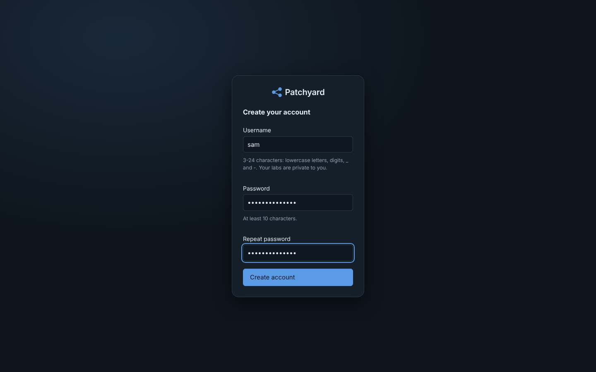

# Hosting Patchyard for other people (public VPS)

This sets Patchyard up on an internet-facing server where several people each have their own account and their own private labs.

## What you get

- **Accounts by invite or by request.** You create invite links (each makes one account), or people request an account from the sign-in page and you approve it. People sign in with a username and password, and only see and change their own labs. Admins see everything.
- **HTTPS.** Caddy runs next to Patchyard with a Let's Encrypt certificate. Patchyard itself only listens on 127.0.0.1.
- **Sandboxed lab devices:**
  - Every device runs as an unprivileged container with only the network capabilities it needs (`NET_ADMIN`, `NET_RAW`) and a memory/CPU cap.
  - Each lab gets its own management network, so one user's devices can't reach another's.
  - Lab devices can't reach the internet, the host, or your other services. The one exception is package downloads (Alpine mirrors) through Patchyard's proxy. Servers and firewalls need those when they start.
- **Limits:**
  - Labs per user, labs running at once, devices per lab, memory and CPU per device.
  - Server-wide defaults, with overrides per user.
- **What users can do inside their labs:** everything the UI offers, including the IOS CLI, FRR, and a Linux shell on their own devices.
- **What they can't do:**
  - import topologies from the server's disk,
  - pick container images you haven't allowed,
  - set privileged/raw containerlab options,
  - change server settings.

## 1. A server

| | Minimum | Better |
| --- | --- | --- |
| CPU | 2 vCPU | 4–8 vCPU (labs are CPU-light but a deploy is bursty) |
| Memory | 4 GB | 8–16 GB (about 512 MB per running device at the default cap; most use far less) |
| Disk | 40 GB SSD | 80 GB |
| OS | Ubuntu 24.04 LTS (tested), Ubuntu 22.04, Debian 12 | |
| Virtualisation | KVM-based VPS (Hetzner, DigitalOcean, Vultr, Linode, OVH, Scaleway…) | |

The VPS needs its own kernel. OpenVZ/LXC "VPS" products don't work. Check with `systemd-detect-virt`: `kvm` or `microsoft` is fine, `openvz` or `lxc` isn't.

Rough capacity at the default limits (1 running lab per user, up to 20 devices): one user with a big lab uses 2–4 GB. An 8 GB server comfortably runs three or four people's labs at the same time. Admins aren't limited.

## 2. DNS

Point a name at the server: for example an `A` record for `lab.example.com` with the server's IPv4 address. The certificate is issued automatically the first time someone opens the site, so the record can be added just before or just after installing.

## 3. Install

Run this as root on a fresh server:

```bash
curl -fsSL https://raw.githubusercontent.com/liamlane/patchyard/main/deploy/install.sh \
  | sudo bash -s -- --public --domain lab.example.com --email you@example.com --admin yourname
```

- `--public` turns on the sandbox and requires the login.
- `--domain` sets up Caddy and HTTPS on ports 80 and 443, and keeps Patchyard on localhost.
- `--admin` names your admin account. You're asked for its password, which needs at least 10 characters.

Then open `https://lab.example.com` and sign in.

## 4. Lock the server down

These are the usual steps for any public server. Do them before you invite anyone.

```bash
# only SSH and the web ports
sudo ufw allow OpenSSH && sudo ufw allow 80/tcp && sudo ufw allow 443/tcp && sudo ufw enable

# SSH with keys only (after you've copied your key with ssh-copy-id)
sudo sed -i 's/^#\?PasswordAuthentication .*/PasswordAuthentication no/' /etc/ssh/sshd_config && sudo systemctl reload ssh

# security updates
sudo apt install -y unattended-upgrades && sudo dpkg-reconfigure -plow unattended-upgrades
```

Docker publishes no ports for Patchyard: everything runs on the host network, and Caddy is the only thing listening on 80/443. Lab devices' management networks are internal.

## 5. Email

Patchyard sends email through your mail provider's SMTP server: account requests to you, approvals and invite links to people, "Forgot password?" links, and alert digests for users who opt in.

1. Your name → **Admin** → **Email**. Pick a provider preset or fill in the server, port, security, username and password (for Microsoft 365 or Gmail, an *app password*). The password is write-only: it's never sent back to the browser.
2. Set the **From address** to one your account is allowed to send as.
3. The **site address** defaults to `https://<your --domain>`; links in emails use it (never the address a request came from).
4. Tick **Send email**, enter your own address and press **Save and send test**. The status line turns to *Working* only once a test was delivered with the settings as they are now; change anything and it asks for a new test.

If the test can't connect, the VPS provider may block outgoing SMTP. Port 587 with STARTTLS is the most likely to be open; port 25 often isn't. Add your own email under Settings → Account so admin emails reach you.

## 6. Two-factor sign-in

On a `--public` server, admins must use two-factor sign-in (an authenticator app on their phone). The first time you sign in after updating to 0.14.0, Patchyard takes you to the setup page:

1. Scan the QR code with Microsoft Authenticator, Google Authenticator, 1Password, Bitwarden or similar.
2. Type the 6-digit code it shows.
3. Save the ten **recovery codes** (copy or download them into your password manager). Each signs you in once if you lose your phone.

From then on, sign-in asks for a code after your password. To require it for everyone, or turn the requirement off, use **Admin** → **Limits & sandbox** → **Sign-in**. Anyone can turn it on for themselves in Settings → Account.

Lost phone and recovery codes:

- someone else: Admin → Users → **Remove 2FA**;
- you (the only admin): `sudo docker exec patchyard python -m app.auth reset-2fa yourname`, then sign in and set it up again.

## 7. Alert channels

Besides the bell and email, alerts can go to your phone and to team chat: **Admin** → **Alert channels** → **Add channel**.

| Type | What you need |
| --- | --- |
| ntfy (phone push) | Install the ntfy app, subscribe to a hard-to-guess topic on ntfy.sh (or your own ntfy server), and enter the topic |
| Microsoft Teams | In the channel: … → **Workflows** → *Post to a channel when a webhook request is received*; paste the URL it gives you |
| Slack | An app with Incoming Webhooks for the channel; paste its `https://hooks.slack.com/…` URL |
| Webhook | Any URL that accepts a JSON POST (optional bearer token) |

Each channel has a minimum severity, an optional list of labs, whether to send "resolved" messages, and quiet hours (critical alerts can break through). **Send test** checks it. Under Settings → Alert rules, **Send to** sends a rule to one channel, or to the bell only. With *Let users get their own labs' alerts on their phone* ticked, each user can enter their own ntfy topic in Settings → Account.

## 8. Let people in

There are two ways in: invite links, and account requests from the sign-in page.

### Account requests

The sign-in page has a **Request one** link. The form asks for full name, email, organisation (optional), username, password, what they'll use it for, and agreement to personal/non-commercial use. When a request arrives you get a toast, a red dot on your avatar, a count in your account menu and, with email set up, an email. Open **Admin** → **Requests**, read it, and **Approve** or **Decline**. With email set up the person is told either way; without it, let them know yourself (their address is on the request).

Turn requests off under **Admin** → **Limits & sandbox** if you only want invites. Each address can send 3 requests an hour, and at most 50 can wait at once.

### Invite links


Click your name (top right), then **Admin** → **Invites** → **Create link**. Send the link. The person enters their name and email, picks a username and password, and lands in an empty workspace, where they can start from a template in the Lab manager.



In **Admin**:

- **Users:** see names and emails, change roles, reset passwords (a new one is shown once), disable or delete accounts, and set per-user limits. The **Lab internet** box gives one user's lab devices full internet access. Leave it off unless you trust them with your server's IP address.
- **All labs:** see every lab and who owns it, open or destroy any of them, move a lab to another user, or mark one **trusted**. A trusted lab runs the old way: privileged, on the shared management network. Use that only for your own labs.
- **Limits & sandbox:**
  - the server-wide default limits,
  - extra images users may choose,
  - the package mirrors labs may reach,
  - the management address pool (default `172.30.0.0/16`, cut into /26 per lab).

## 9. Check it works

After installing or updating, run the self-test. It deploys real labs through the API, waits for routing and services, checks them, and cleans up:

```bash
sudo docker exec patchyard python -m app.selftest          # OSPF triangle, about 2 minutes
sudo docker exec patchyard python -m app.selftest --full   # also the small office: firewall, DHCP, DNS, web, PAT
```

Every line should be a ✓. On a `--public` server it also checks the lab egress firewall and the package proxy.

## How the sandbox works

| Threat | What stops it |
| --- | --- |
| Root on the host from a device shell | Devices are unprivileged containers with only `NET_ADMIN` + `NET_RAW`, inside their own network namespace. Sysctls they'd need (`ip_forward`, MPLS) are set by Patchyard from outside. |
| Reaching another user's devices | Each lab has its own Docker management network (containerlab `external-access: false`); Docker isolates them from each other. Data-plane cables are veth pairs between that lab's own devices. |
| Attacking the internet from your IP | An nftables table on the host (`ip patchyard`) rejects any traffic from the lab pool except replies, and Alpine package downloads (`apk`) go through Patchyard's proxy, which only connects to the allowed mirrors on ports 80/443. |
| Reaching the host's services | The same table rejects lab traffic to the host except the proxy port; Patchyard's own web port is bound to 127.0.0.1. |
| Using up the server | Memory and CPU caps per device, limits on devices, labs and running labs per user, and a disk allowance per user (lab folders, uploads, snapshots). Labs that keep growing past it are paused and their owner emailed. |
| Mounting host folders or running odd images | Normal users can't import from a host path or set raw containerlab options (privileged, binds outside the lab, devices, network mode…). They can only pick images from the allowed list. |
| Seeing or changing other users' labs | Every `/api/labs/<lab>/…` request and console WebSocket is checked against the lab's owner. Someone else's lab answers "not found". |
| Password guessing | 8 failed logins per username (20 per address) in 15 minutes locks further tries for 15 minutes. Passwords are PBKDF2-SHA256 with 240,000 rounds. |
| Cross-site requests | State-changing requests with a foreign `Origin` are refused, and the session cookie is `SameSite=Lax`, `HttpOnly` and `Secure` over HTTPS. |

**Limits worth knowing:**

- A user with a shell can still use their own devices' CPU and memory up to the caps.
- The disk allowance covers each user's lab folders. A container's own filesystem (packages a user installs from a shell) lives in Docker's storage and isn't counted; device memory caps limit what tmpfs can hold.
- All lab devices share the host kernel, like every container platform. Keep the kernel patched (unattended-upgrades).
- Everyone can see the server's version and which kernel features it has.

## Backups

Everything lives in `/opt/patchyard`:

- `users.json` (accounts, invite hashes, account requests and password-reset hashes),
- `audit.log` (who did what),
- `challenges/` (challenges published to everyone),
- `settings.json` (including the SMTP password; the file is readable by root only),
- `secret.key` (session signing),
- `labs/` (every lab, config and snapshot),
- `metrics.db`,
- `caddy/` (certificates).

Back up that folder, for example with a nightly `restic` or `rsync` to another machine. A user's running configs are saved whenever they deploy, destroy, snapshot or press *Save running configs*.

## Day to day

```bash
sudo /opt/patchyard/deploy/update.sh                              # update to the latest release
sudo docker logs -f patchyard                                     # app log
sudo docker logs -f patchyard-caddy                               # HTTPS / certificate log
sudo docker exec patchyard python -m app.auth list                # accounts
sudo docker exec patchyard python -m app.auth reset-password NAME # prints a new password
sudo docker exec patchyard python -m app.auth reset-2fa NAME      # removes two-factor sign-in (lost phone)
sudo nft list table ip patchyard                                  # the lab egress firewall and its counters
sudo docker exec patchyard python -m app.selftest                 # deploy a lab and check it end to end
```
